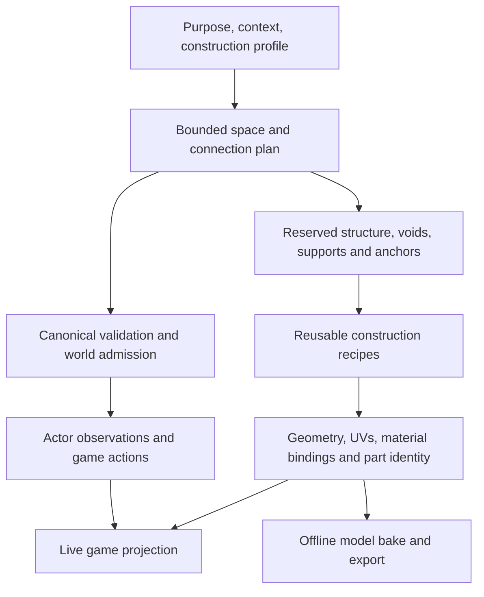

# Purposeful generation: preserve the capabilities, improve the composition

Design memo • 26 October 2026 • Read-only research with local planning documents

## Recommendation

Keep the working generation, stairs, shelves, material handling, and canonical game systems. Evolve the dungeon planner so it chooses the kind of place it is creating before choosing its dimensions and connections. Continue developing reusable construction recipes that produce geometry, meshes, UVs, materials, attachment points, and useful metadata. Those recipes should serve both the playable construction playground and, later, offline model production.

The enduring product is the ability to construct things. A dungeon, a shelf, a staircase, a house, and eventually a settlement are compositions at different scales. A generated model is one output of that capability; it should not replace or discard the source recipe that can regenerate and vary it.

The immediate recommendation is an incremental extension of the existing modules-v3 algorithms, with explicit architectural intent and a new experimental recipe interpretation where necessary. Keep its bounded search, occupancy reservations, deterministic proposals, transaction fences, and disclosure boundaries. Start with empty chambers, then introduce circulation modules and deliberately allocated stairwells. Preserve the current straight-stair construction and crossing behavior while changing how the surrounding space is planned. Extend the framing and furnishing systems after space composition becomes meaningful.

This memo changes no implementation. It does not authorize a merge, an asset import, a browser-save reset, or paid generation. Disposable prototype saves need not impose migration work on a later authorized implementation.

## Why the current output looks room-heavy

The current player path creates a spatial recipe, reserves a chamber behind every expansion socket, optionally inserts a short passage, then derives interiors from a seed-selected obstruction pattern. Semantic purpose does not influence those choices. Later, the scene compiler independently attempts shelves on eligible room walls.

I measured the actual domain functions in memory across eight seeds at depths 1, 10, and 30, for ordinary and spatial profiles. These are controlled floor samples, not a playthrough or a fresh browser qualification.

| Finding | Consequence |
| --- | --- |
| All 48 sampled floors passed the existing structural graph predicate | The assembler is useful; graph qualification alone does not establish architectural quality |
| Spatial passages occupy about 1.08–1.19% of room-plus-passage footprint area | Most navigable places are necessarily chambers; passages are short additions between them |
| None of 800 sampled spatial chambers had a fully open interior mask | Empty-by-default requires a domain schematic change, not just a texture or prop change |
| The spatial policy raises every chamber's minimum side to 9 cells | A local stair-layout requirement currently affects all chambers |
| A policy-only experiment with 5–7-cell chambers and passage-only joins raised passage area to about 9.3–9.5% | Tuning improves the proportions but cannot produce circulation without a chamber behind each passage |
| A separate complete-room scene diagnostic placed shelves in all 128 sampled rooms | Remove unconditional placement from the baseline; retain the shelf generator and fit/rendering machinery |

The passage-area metric uses rectangular footprints before interior obstructions. Scene diagnostics deliberately supplied complete synthetic structural-room disclosure; they do not establish what a player lawfully sees or how the browser performs. Exact inputs, per-floor data, maps, and limitations are in the [evidence document](evidence-and-reproduction.md).

## What to preserve

The latest relevant Maze Battle checkout is `C:/Users/Zythis/.codex/worktrees/canonical-3d-exploration/maze-battle`, branch `codex/canonical-3d-exploration`, HEAD `4640157e1136effed3aeefef05cf7a4c7e62b9af`, with active uncommitted work. The launch checkout is an older `codex/streaming-exploration` branch. The plan is grounded in the former; neither checkout was changed except for this new planning folder in the launch checkout.

Preservation means retaining implementation, tests, selected asset packages, source pins, and development evidence. It does not mean retaining every historical placement policy.

- **Stairs:** retain reusable `straightStair`, its anchors/clearances, reserved shafts, deck cuts, floor registration, canonical travel, manual traversal, accepted Auto replay, cancellation/recovery, and tests. Reconcile active stair-finish and support work before changing overlapping renderer files.
- **Shelving:** retain TileLab's bounded shelf/bookcase/cabinet construction, board/beam reuse, storage-bay metadata, mounting, hinged poses, deterministic contents, portable exports, consumer fitting, batching, and tests. A baseline room can omit shelves while a library explicitly selects them.
- **Timbers and materials:** retain clipping/union math, grain direction, end-grain separation, shared datums, source textures, material imports, batching, and disposal. Add construction-member identity and support intent where coverage math is insufficient.
- **World authority:** retain seeded identity, lawful sockets, occupancy, bounded preparation, atomic commits, gameplay-owned content/travel, and actor-scoped observation shared by 2D and 3D.

The full [preservation and source register](sources-and-preservation.md) records dirty scope, hashes, source-document revisions, and historical findings that current code supersedes.

## The construction direction

For the game, the canonical world admits geometry and owns behavior. For asset production, an explicit authoring context can compile a complete object or building. Both paths should use the same construction recipes. Do not export a partially observed player scene and treat it as a complete architectural model.

## Ordered work

1. Reconcile the active stair/shelf/timber changes and preserve their evidence in the implementation owner's branch. Establish repeatable seed comparisons and explicit construction intent.
2. Introduce a versioned empty-interior interpretation and an explicit furnishing policy. Existing shelf capabilities remain available through purposeful fixtures and the workshop.
3. Extend socket targets to circulation, junctions, and chambers. Update the room-based counters, IDs, quality reductions, capacity estimates, role allocation, and disclosure together in a bounded experimental vertical.
4. Allocate dedicated entry/exit stairwell modules with reserved envelopes before adjacent geometry. Initially reuse the working stair dimensions and crossing algorithm; compact or turning stairs are subsequent recipe variants.
5. Add named framing members and purpose-driven furnishing anchors to selected profiles, retaining current mesh generation as a backend.
6. Prove export with one shelf/cabinet and one stairwell assembly, then one building. Test the exported object by importing it independently before attempting village or city composition.

Detailed alternatives, proposed contract sketches, exact integration surfaces, and acceptance checks are in [architecture and implementation slices](architecture-and-slices.md).

No owner decision blocks this planning result. The first visual comparison should settle provisional room scale and circulation proportions; a permanent style baseline, more elaborate stair families, and export feature coverage can remain open until their respective proofs.
